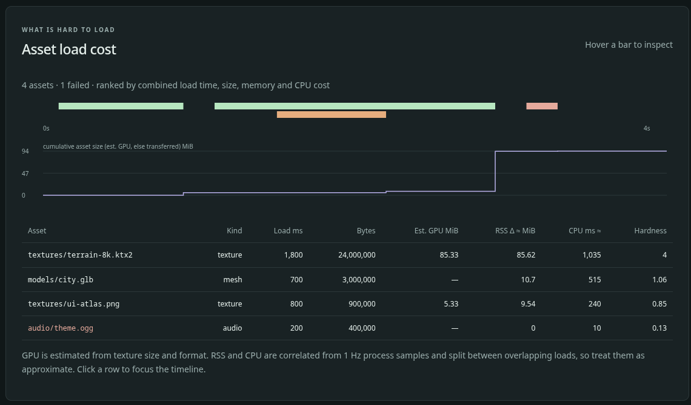

# Find the assets that are expensive to load

<span class="badge badge-preview">Preview</span> <span class="badge">Profiler main branch</span> <span class="badge badge-warn">No producer yet</span>

Which textures and files make your game slow to start, or heavy once it is running? The profiler can answer that from
`asset` records: for each asset, **when** it loaded, **how big** it was, and what it cost in **memory, CPU and
(estimated) GPU**. It ranks them by a combined score, so the worst offender is at the top.

This works in the profiler's `main` branch ([vapour-profiler#2](https://github.com/vapour-computer/vapour-profiler/pull/2)).
It is not in a release yet.

## What is real today, and what is not

| Part | State |
| --- | --- |
| The `asset` record in the `.vpt` v1 format and its JSON schema | **Merged** to the profiler `main` branch |
| The analyzer that ranks assets and estimates GPU size | **Merged**, with unit tests (validation, GPU maths, overlapping loads, a sample fixture) |
| The dashboard's **Asset load cost** panel and `GET /api/assets` | **Merged**; we ran it on the sample trace below |
| Something that **creates** `asset` records from a running game | **Does not exist in the repository.** The author ran Godot and Bevy builds through a scratch page hook that is not committed |
| A live native capture filling the panel | **No.** It shows "No recorded assets", because the native profiler records only CPU and memory |
| Unity | **Not tested.** The author's headless Unity build failed on licensing |
| WebGPU | **Not exercised.** The hook paths were written but not run |

So today you can **open a trace that contains `asset` records** and see the panel. Nothing in this repository writes such a
trace for you yet.

## The panel



*The profiler built from its `main` branch, opening the repository's own sample trace
([`assets-sample.vpt`](../.gitbook/assets/assets-sample.vpt)). This is illustrative data, not a real game.*

| Part | What it shows |
| --- | --- |
| **Lane timeline** | One bar per load, from its start to its end. Bars that overlap in time are stacked in separate lanes (up to 40 lanes). Colour is the kind: texture green, mesh orange, audio purple, shader teal, wasm red, data yellow, other grey. A **failed** load is drawn in red-pink (the same colour as `wasm`, so check the table) and its row text is red |
| **Cumulative size** | A step line: the running total of asset size after each load finishes. It uses estimated GPU bytes where there are some, and transferred bytes otherwise |
| **Table** | Every asset, hardest first. Click a column header to sort, again to reverse. It shows at most the top 300 rows |

The columns:

| Column | Meaning |
| --- | --- |
| **Asset** | The asset's name, usually its URL or path |
| **Kind** | `texture`, `mesh`, `audio`, `shader`, `wasm`, `data` or `other` |
| **Load ms** | End time minus start time |
| **Bytes** | Bytes transferred, as reported by the producer. `—` if not reported |
| **Est. GPU MiB** | Estimated GPU memory, for textures only. `—` otherwise |
| **RSS Δ ≈ MiB** | Approximate growth in resident memory attributed to this load |
| **CPU ms ≈** | Approximate CPU time attributed to this load |
| **Hardness** | The combined score, from 0 to 4 (see [below](#the-hardness-score)) |

**Hover** a bar to see its name, load time, estimated GPU size and transferred size. **Click** a bar or a table row to zoom the
whole dashboard's shared time window onto that load, so the CPU and memory charts show what the machine was doing then.
The **Full capture** button brings the full range back.

## The `asset` record

An `asset` record is one line of a `.vpt` file (see [Export and validate dumps](dumps.md)). Producers report **facts only**;
the profiler derives everything else.

One full record is on the third line from the end of the sample trace, [`assets-sample.vpt`](../.gitbook/assets/assets-sample.vpt).

| Field | Required | Type and limits | Meaning |
| --- | --- | --- | --- |
| `type` | yes | `"asset"` | |
| `id` | yes | string, 1–256 characters, **unique** in the file | A stable identifier |
| `name` | yes | string, 1–1024 characters | URL or path |
| `kind` | yes | `texture`, `mesh`, `audio`, `shader`, `wasm`, `data`, `other` | What it is |
| `startMs` | yes | time in milliseconds from capture start | When loading began |
| `endMs` | yes | time, **at least** `startMs` | When loading finished |
| `bytes` | no | count | Bytes transferred |
| `decodeMs` | no | time | Time spent decoding |
| `jsHeapDeltaBytes` | no | integer, may be negative | JavaScript heap change measured around the load |
| `wasmDeltaBytes` | no | integer, may be negative | WebAssembly memory change measured around the load |
| `texture` | no | object, below | For textures: what the GPU holds |
| `failed` | no | boolean | The load did not succeed |

The `texture` object:

| Field | Required | Limits | Meaning |
| --- | --- | --- | --- |
| `width`, `height` | yes | integer, 1–65536 | Size in pixels |
| `format` | yes | string, 1–64 characters | For example `rgba8`, `bc7`, `astc_6x6` |
| `mips` | no | boolean | Whether a mipmap chain is stored |
| `layers` | no | integer, 1–4096 | Array layers or cube faces. Default 1 |

Rules the importer enforces:

- **No unknown fields.** The schema rejects extra keys, so a typo is an error, not silently ignored.
- **Unique `id`.** A repeat is rejected with `Duplicate asset id`.
- **A valid interval.** `endMs` before `startMs` is rejected with `Invalid asset interval`.
- **Asset records are not time-ordered.** They are written when a load *finishes*, so they are exempt from the rule that
  other record kinds must be monotonic in time.

The record was added to version 1 **additively**, before any consumer release. A later breaking change must bump `version`.

## Facts and estimates

The panel mixes two kinds of numbers. They are not equally trustworthy.

| Source | Values |
| --- | --- |
| **Facts from the producer** | `bytes`, `decodeMs`, `jsHeapDeltaBytes`, `wasmDeltaBytes`, and the texture's size, format, mips and layers |
| **Computed exactly from those** | `loadMs`, and the sort order |
| **Estimates by the analyzer** | `estGpuBytes`, `rssDeltaApprox`, `cpuMsApprox`, and so `hardness` |

The estimates are **approximate and labelled so** (the `≈` in the column headings). Treat them as a way to rank, not to bill.

### Estimated GPU size

For a texture, the analyzer computes:

```text
estGpuBytes = width × height × bytesPerPixel × mipFactor × layers
mipFactor   = 4/3 when mips is true, otherwise 1
```

Bytes per pixel come from the format name (case-insensitive). Block-compressed formats are expressed per pixel:

| Format | Bytes per pixel |
| --- | --- |
| `r8`, `r8unorm`, `alpha`, `luminance` | 1 |
| `rg8`, `rg8unorm`, `rgb565`, `rgba4`, `rgb5_a1`, `r16f`, `depth16` | 2 |
| `rgb8` | 3 |
| `rgba16f`, `rg32f` | 8 |
| `rgba32f` | 16 |
| `bc1`, `dxt1`, `etc1`, `etc2`, `etc2_rgb` | 0.5 |
| `bc3`, `bc5`, `bc7`, `dxt5`, `etc2_rgba`, `astc_4x4` | 1 |
| `astc_6x6` | 0.444 |
| `astc_8x8` | 0.25 |
| **anything else** | **4** (assumed RGBA8) |

The fallback matters: a texture with a format name that is not in this table is **assumed to be 4 bytes a pixel**, which may
over- or under-state it. Worked examples, all checked against the analyzer's tests:

| Texture | Estimate |
| --- | --- |
| 1024 × 1024 `rgba8`, with mips | 5,592,405 bytes |
| 1024 × 1024 `BC7`, 2 layers | 2,097,152 bytes (2 MiB) |
| 8192 × 8192 `bc7`, with mips | 89,478,485 bytes (**85.33 MiB**, the top row in the screenshot) |

The estimate is what the GPU would hold for that texture. It is not measured, and it ignores driver padding and any
compressed copy kept in system memory.

### Approximate memory and CPU

Neither is measured per asset. Both are **correlated** from the trace's once-a-second `metrics` records, so a trace needs those
(with `rssBytes` and `cpuOneCorePercent`) for these two columns to have values; without them they show `—`.

- **RSS Δ ≈:** the analyzer takes the metric samples just before the load started and just after it finished, and subtracts
  the resident memory. If other loads overlap that window, the growth is **split between them**, in proportion to their
  `bytes` (an asset with no `bytes` counts as 1). The `concurrentLoads` field says how many shared the window.
- **CPU ms ≈:** the one-core CPU percentage of each sample interval, multiplied by how much of the interval the load
  overlapped, summed over the load.

Because samples are one second apart, a load shorter than a second shares its bucket with whatever else ran, and its
numbers are blurry. That is why they are marked approximate.

## The hardness score

Hardness ranks assets by adding up four costs, **each divided by the largest value of that cost among all assets**:

| Cost | Taken from |
| --- | --- |
| Load time | `loadMs` |
| Size | `estGpuBytes`, or `bytes` if there is no estimate, plus any positive `jsHeapDeltaBytes`. Counted only when the asset has one of those sizes |
| Memory | `rssDeltaApprox`, if positive |
| CPU | `cpuMsApprox` |

Each term is between 0 and 1, so hardness is between **0 and 4**. An asset that is the worst in every category scores exactly 4.
A cost that is missing counts as 0. The score is rounded to three decimals and the list is sorted highest first.

In the sample trace, `terrain-8k.ktx2` is the heaviest on all four, so it scores **4**. `city.glb` scores 1.06, `ui-atlas.png`
0.85, and the failed `theme.ogg` 0.13. Hardness is relative: it compares assets **within one trace** and says nothing across
traces.

## Try it

```sh
vapour-profiler dashboard
```

Open the printed address in Chromium, click **Open dump**, and choose the sample trace
[`assets-sample.vpt`](../.gitbook/assets/assets-sample.vpt). It has four assets and five metric samples over four seconds. You should see exactly what
the screenshot above shows. Importing starts no probes.

## The API

```sh
# the token is the part after #token= in the dashboard address the profiler printed
curl -s -H "Authorization: Bearer $TOKEN" http://127.0.0.1:6767/api/assets
```

The response is a JSON object with an `assets` list for the retained trace, hardest first, and an empty list if there are no `asset` records.
Like every `/api/*` route it needs the session token; see [Local agent and port 6767](../telemetry/local-agent.md). Each entry has these fields:

```text
id, name, kind, startMs, endMs, loadMs, bytes, decodeMs, failed,
jsHeapDeltaBytes, wasmDeltaBytes,
estGpuBytes, rssDeltaApprox, concurrentLoads, cpuMsApprox, hardness
```

## In reports

When a trace has assets, the [offline and Claude reports](reports.md) get extra evidence they can cite:

- `assets`: the count, how many failed, and for each kind the count and total bytes.
- `asset_0` to `asset_9`: the ten hardest assets, each with its name (cut to 128 characters), kind, load time, bytes,
  estimated GPU bytes, approximate RSS and CPU, and hardness.

## Known gaps

These are listed in the pull request, and we repeat them so you do not trip over them:

- **No producer.** Until something emits `asset` records, the panel stays empty for real runs.
- **Godot textures are anonymous.** Godot packs everything into one `index.pck`, so a hook sees the texture uploads but not
  which file each came from. Bevy, which loads files separately, has real names.
- **Buffers inflate the total.** In the author's Godot run, GPU buffers were counted as assets, so the cumulative line reached
  about 5.1 GiB while resident memory was about 2.8 GiB. Whether buffers should count is an open product decision.
- **Unity and WebGPU are unverified**, as in the table at the top.
- **Schema pin.** The browser telemetry package pins the older v1 schema, which has no `asset` record. See
  [the pins](dumps.md#the-two-schema-pins).
