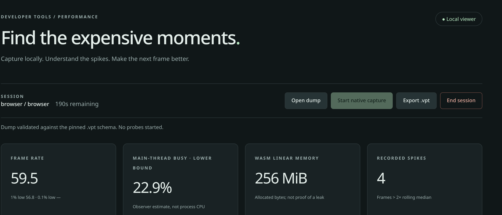
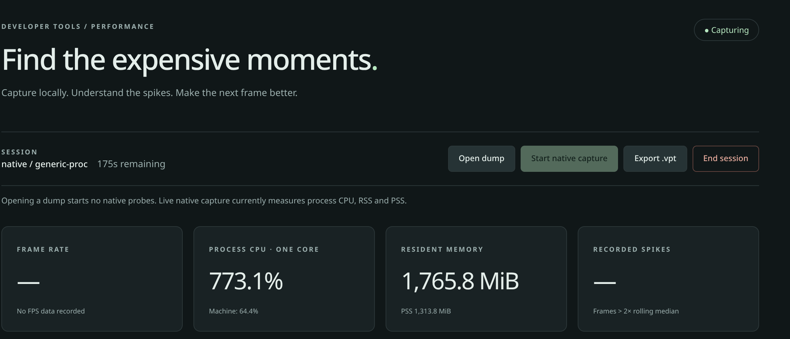
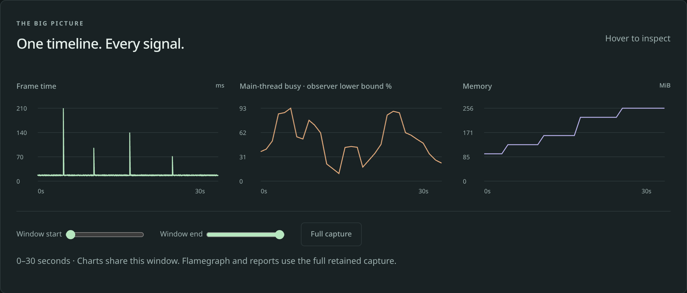
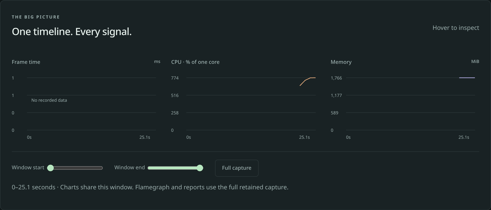
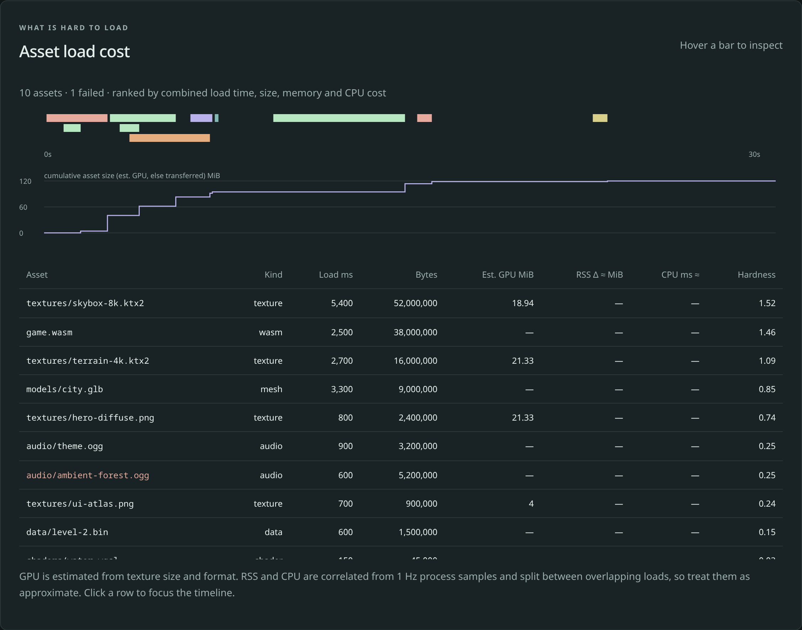
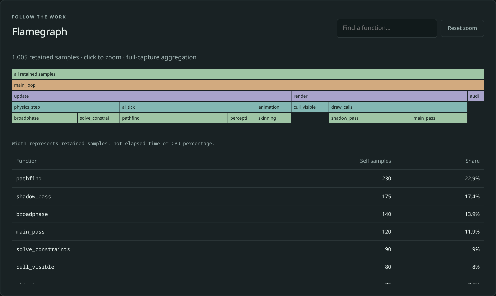
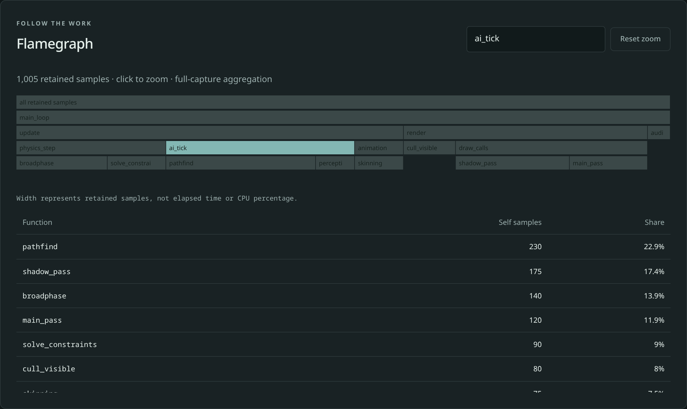
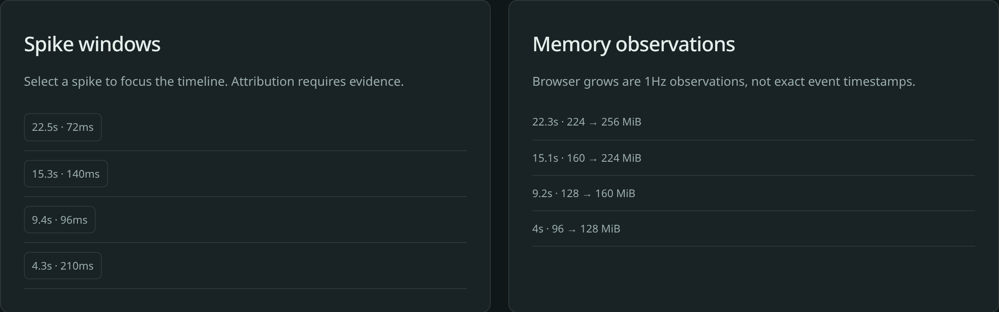
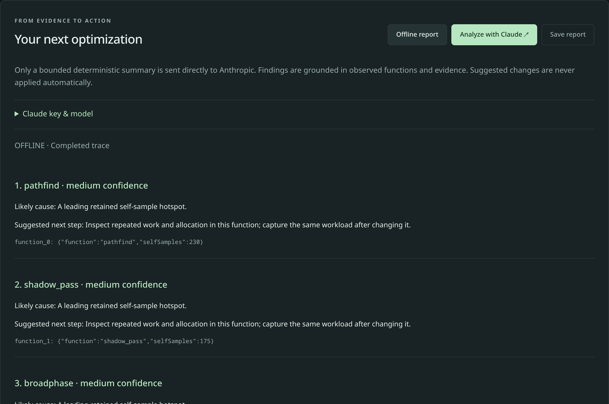
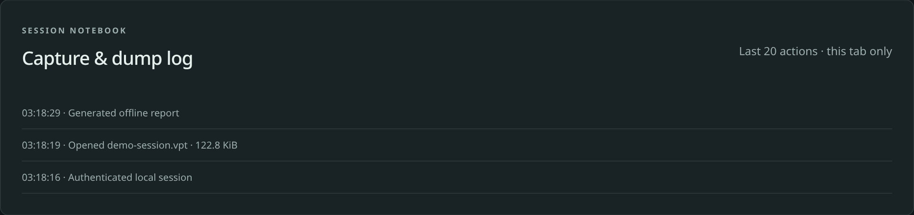

# Understand your game's performance

<span class="badge badge-preview">Preview</span> <span class="badge">Runs on your computer</span> <span class="badge">About 15 minutes</span>

Before you publish, you want to know three things: **Is my game smooth? Where is it slow? Does it use too much memory?** The
performance page answers all three, on your own computer, without uploading anything. This guide walks through **every part of
that page**, what each number means, and what to do about it.

You do not need to know how it works inside. If you can read a chart, you can use it.

> **Your game is never touched.** The page measures your game while you test it. It adds nothing to the build you publish, and
> nothing is sent to Vapour.

## Open it

From your game's folder, run one command:

```sh
vapour test
```

A browser window opens with your game in one tab and this page in the other. Play your game for a minute, then switch to the
page. Close the browser when you are done and everything is cleaned up.

Two things to know before you start:

- The command is in **preview**. See [what is available today](../status.md).
- Measuring a running game needs **Linux**. On other systems `vapour test` still shows the FPS counter on the game itself.
  [Profile your game locally](../tutorials/profile-locally.md) covers the options.

You can also open a **saved recording** (a `.vpt` file) to look at a past session. Everything below applies to both. To try it
without a game, download the [demo recording](../.gitbook/assets/demo-session.vpt), which is made-up data for practice, and open it
with the **Open dump** button.

## The page at a glance

The left menu jumps to each section: **Overview**, **Assets**, **Flamegraph**, **Optimization** and **Capture log**. At the
bottom of the menu it reminds you: *On your machine. No telemetry uploads. No cloud dashboard dependency.*

The sections, top to bottom:

| Section | Answers |
| --- | --- |
| [Session bar and four tiles](#1-the-session-bar-and-the-four-tiles) | How is it going, in four numbers? |
| [Timeline](#2-the-timeline) | When did things go wrong? |
| [Asset load cost](#3-asset-load-cost) | Which files are heavy to load? |
| [Flamegraph](#4-flamegraph) | Which parts of my code take the time? |
| [Spikes and memory](#5-spike-windows-and-memory-observations) | Exactly when did it stutter or grow? |
| [Your next optimization](#6-your-next-optimization) | What should I fix first? |
| [Capture log](#7-capture-and-dump-log) | What did I just do? |

## 1. The session bar and the four tiles

[](../assets/img/telemetry-session-and-tiles.png)

*A saved practice recording (made-up data).*

### The session bar

| Part | What it means |
| --- | --- |
| The badge at the top right | **Local viewer** when you are looking at a saved recording. **Capturing** while a live measurement is running |
| **Session** | Where the numbers come from. `browser / browser` is a recording made by a browser. `native / generic-proc` is a live measurement of a program on your computer |
| **… remaining** | A live session lasts at most **five minutes**, then it stops by itself. Run `vapour test` again for another |
| **Open dump** | Open a saved recording. Nothing is measured when you do, it is only read |
| **Start native capture** | Start a live measurement. `vapour test` has already done this for you |
| **Export .vpt** | Save what you have so far as a file you can reopen later or share |
| **End session** | Stop and close |

Below the bar, one line of text tells you what just happened, for example *Dump validated … No probes started*, or what a live
measurement covers.

### The four tiles

| Tile | What it tells you | What to look for |
| --- | --- | --- |
| **Frame rate** | How many pictures per second your game draws, on average. Below it, the **1% low** and **0.1% low**: how fast your *worst* moments were | A good average with a bad 1% low means stutter. **60** is the usual target on a normal screen. See [why the 1% low matters](../tutorials/profile-locally.md#the-speed-counter) |
| **Main-thread busy** (recordings from a browser) | How much of the time your game's main thread was busy. It is an **estimate that can only be too low**, never too high | Near 100% means the game has no spare time and will hitch |
| **WASM linear memory** (recordings from a browser) | How much memory your game asked the browser for | It only goes up. Growth is normal while loading; steady growth while you stand still is worth a look. The tile reminds you it is *not proof of a leak* |
| **Recorded spikes** | How many frames took more than **twice** as long as the ones before them | Each one is a stutter a player could feel |

A tile shows **—** when that measurement does not exist for this kind of session. Nothing is invented to fill the gap.

### The same tiles for a live measurement

[](../assets/img/telemetry-live-session.png)

*A real live measurement of the Godot TPS demo, captured in a browser without a graphics card, so the numbers are high.*

A live measurement has different tiles:

| Tile | What it means |
| --- | --- |
| **Frame rate** | **—** with *No FPS data recorded*. The live measurement does not count frames. Use the [FPS counter](../tutorials/profile-locally.md#the-speed-counter) on the game for that |
| **Process CPU · one core** | How hard the processor is working for your game. **100% is one full processor core**, so `773%` means about seven and a half cores busy. Below it, **Machine** says what share of the whole computer that is |
| **Resident memory** | The memory your game's browser is using right now. **PSS** underneath is a fairer figure that counts memory shared with other programs only once |
| **Recorded spikes** | **—**, because it needs frame data |

## 2. The timeline

[](../assets/img/telemetry-timeline.png)

*The same practice recording.*

Three charts share one time axis, so you can read straight down from a spike to what the memory and the processor were doing.

| Chart | How to read it |
| --- | --- |
| **Frame time** | How long each frame took, in milliseconds. A healthy game is a flat low line (about 16 ms for 60 FPS). Every **tall line is a stutter**. Here there are four, at roughly 4, 9, 15 and 22 seconds |
| **Main-thread busy** | The busy estimate over time. Hills mean busy periods |
| **Memory** | A staircase: each step is the game asking for more memory. Four steps here, each at almost the same moment as one of the stutters. A stutter and a memory step together usually mean the game was **loading something** |

**Hover** over a chart to read exact values. **Window start** and **Window end** are sliders that zoom all three charts to the part you care
about, and **Full capture** puts them back. The flamegraph and the report always use the **whole** recording, even when you have
zoomed.

For a live measurement the first chart is empty (no frames are counted) and the other two show processor and memory:

[](../assets/img/telemetry-live-timeline.png)

## 3. Asset load cost

[](../assets/img/telemetry-assets.png)

*Made-up data for ten files, one of which failed to load (shown in red).*

This section ranks your textures, models, sounds and other files by **how hard they were to load**.

- **The coloured bars** show *when* each file loaded and for how long. Overlapping loads are stacked. Colours are by kind: textures green, models orange, sounds purple, shaders teal, code red, data yellow. **Hover** a bar for its name, time and size.
- **The step line** is the running total size. A big step is a big file arriving.
- **The table** lists every file, hardest first. **Click a column heading** to sort. **Click a row** (or a bar) to zoom the timeline onto that load and see what the game was doing then.
- **Hardness** combines how long a file took, how big it is, and its memory and processor cost into one number from 0 to 4. Use it to decide what to shrink first. It only compares files **within this recording**.
- A file that **failed** to load has its name in red.

The columns that end in **≈** (memory and processor) are rough estimates. The page says so itself.

> **Today this section stays empty during a live `vapour test`.** Nothing records file loads from a running game yet, so it fills
> only from a recording that already contains them, like the practice recording here. See [Find expensive assets](../analysis/assets.md).

## 4. Flamegraph

[](../assets/img/telemetry-flamegraph.png)

*Made-up data.*

The flamegraph shows **where your code spends its time**, as stacked boxes. The bottom box is the whole program; each box above it is something it calls.

- **A box's width is how often that function was caught running**, not how long it ran. Wide boxes are where the time goes.
- **Click a box** to zoom into it. **Reset zoom** zooms back out.
- **The table underneath** ranks every function by how often it was caught (**Self samples**) and its **Share** of the total. Here `pathfind` has 22.9%, so it is the first thing to look at.
- A recording with no function information shows a message instead of boxes. The page never makes up callers it did not see.

Type a name in the **search box** and matching boxes light up, so you can find a function at a glance:

[](../assets/img/telemetry-flamegraph-search.png)

> **A live `vapour test` does not fill the flamegraph yet.** It records processor and memory only. Open a recording that has function
> information to use it.

## 5. Spike windows and memory observations

[](../assets/img/telemetry-spikes-memory.png)

| Panel | What it tells you |
| --- | --- |
| **Spike windows** | Each stutter, as a button such as `15.3s · 140ms`: when it happened and how long the frame took. **Click one** to zoom all the charts onto it |
| **Memory observations** | Each time memory grew, such as `4s · 96 → 128 MiB`. Browsers report growth once a second, so treat the time as "around then", not exact |

Matching a spike to a memory step is the quickest way to find a stutter caused by loading.

## 6. Your next optimization

[](../assets/img/telemetry-report.png)

*An offline report on the practice recording. It is cut off here; the real list continues.*

This is the "what do I fix first" part. Click **Offline report** and the page ranks its suspects, with a **confidence** (low, medium) and a **suggested next step** for each.

| Control | What it does |
| --- | --- |
| **Offline report** | Works it out on your computer. Nothing leaves it |
| **Analyze with Claude** | Optional. Sends a **short summary** (not your game) to Claude for a written analysis. It only runs when you click it, and needs your own key. See [Claude keys](../auth/claude-keys.md) |
| **Claude key & model** | Opens the settings for that key and which model to use |
| **Save report** | Saves the findings as a file |
| **Use current summary as comparison baseline** | Remembers this run, so after you fix something you can run again and see what changed |

Every finding quotes the evidence it is based on, such as `pathfind: 230 samples`. **The page only suggests; it never changes your game.**

How to use it well: fix the top suspect, run again, and compare. [Read a performance report](../analysis/worked-example.md) goes through one in detail.

## 7. Capture and dump log

[](../assets/img/telemetry-log.png)

A short diary of the last **20 things you did** in this tab: opened a recording, made a report, started a session. It is there so you can
remember what you were looking at. It lasts only as long as the tab does.

At the very bottom of the page you will see the limits: measurements are taken once a second, a session lasts at most five minutes, and a recording can be up to 50 MiB.

## What it cannot tell you yet

Being clear about this saves you time:

- **No frame rate from a live measurement.** Use the FPS counter on the game, or open a recording that has frames.
- **No per-function view from a live measurement.** It shows processor and memory only.
- **No graphics-card timing.** Frame rate is what the browser actually shows, not how long the graphics card worked.
- **The file-loading section needs a recording that contains file loads.**
- **Unity.** Unity builds have not been tested with it.

## A five-minute routine

1. `vapour test`, then play the part of your game you worry about for a minute.
2. Check the **tiles**. Is the 1% low much worse than the average?
3. Look at the **timeline**. Where are the tall spikes? Is memory stepping up?
4. Click a **spike window** to zoom in, then look at the **asset table** for something heavy loading at that moment.
5. Make one change, run again, and use the **comparison baseline**.
6. When you are happy, [publish](../games/publish.md).
