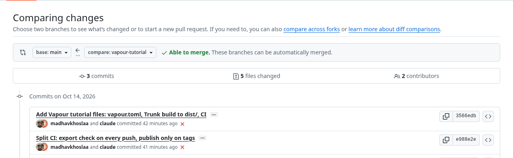
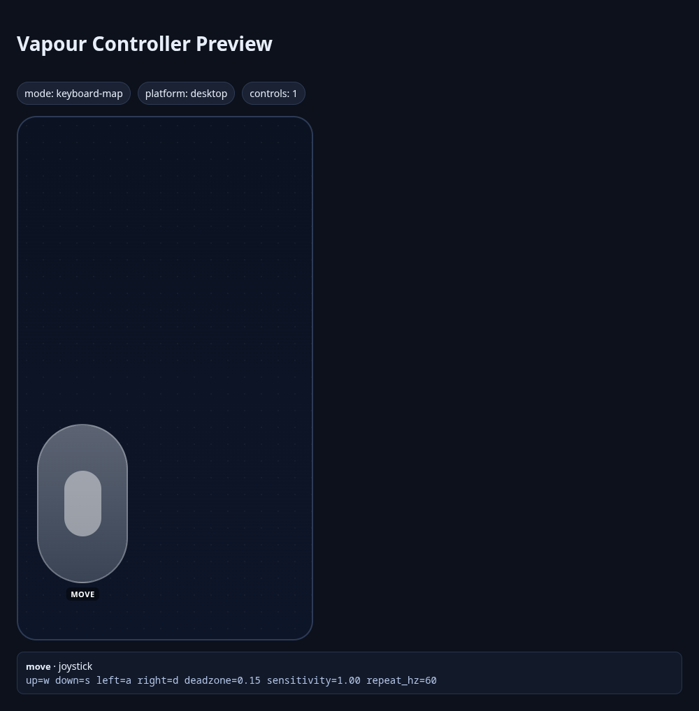
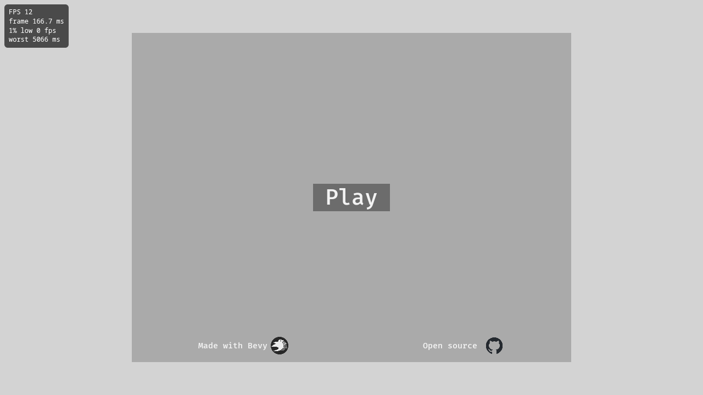

# Tutorial: Bevy, from a Rust template to a web build

<span class="badge badge-preview">Preview tools</span> <span class="badge">Bevy 0.20</span> <span class="badge">Rust 2024</span> <span class="badge">About 25 minutes</span>

You will take a Bevy game template, build it for the browser with **Trunk**, describe the build in `vapour.toml`, add an
on-screen stick for phones, run it locally with the FPS overlay and profiler, and set up CI.

**Sample repository:** [`vapour-computer/tutorial-bevy-template`](https://github.com/vapour-computer/tutorial-bevy-template),
branch `vapour-tutorial`. It is a fork of [`NiklasEi/bevy_game_template`](https://github.com/NiklasEi/bevy_game_template) (CC0).

## What is verified, and what is not

| Step | State |
| --- | --- |
| The web bundle builds | **Verified** on GitHub Actions: the `vapour-check` workflow passes. The bundle is 35 MB |
| `vapour controller check` accepts the layout | **Verified** |
| `vapour test` serves that bundle with the FPS overlay | **Verified.** We downloaded the exact bundle CI built and ran it (screenshot below) |
| `vapour publish --dry-run` packs it | **Verified**: 9.5 MiB |
| The profiler, and `vapour build` on this project | **Not run.** We could not install Trunk locally (see [the Trunk trap](#a-trap-we-hit-installing-trunk)), and `vapour build` calls it |
| The stick working on a real phone | **Not verified.** Preview feature, not tested on a device |
| Publishing to Vapour | **Not run.** Needs your token and a released `vapour-ci` |

## 1. Get the project and the tools

```sh
git clone https://github.com/vapour-computer/tutorial-bevy-template.git
cd tutorial-bevy-template
git checkout vapour-tutorial
```

GitHub's comparison of the branch with upstream shows everything we added:



*The red crosses are earlier CI runs that failed or were cancelled while we fixed the workflow (see [CI](#6-ci)).*

You need a recent stable **Rust**, the WebAssembly target, and **Trunk**:

```sh
rustup target add wasm32-unknown-unknown
cargo install --locked trunk
```

### A trap we hit installing Trunk

On our machine (a current Arch Linux with GCC 16) `cargo install trunk` failed. The build of a C dependency,
`libdeflate-sys`, stopped with AVX-512 errors, and switching the compiler to `clang` did not help. If this happens to you,
install a prebuilt Trunk instead (your package manager, or the project's release binaries). GitHub's Ubuntu runners
compile it without trouble, which is why the CI build below works.

## 2. Look at how the template builds

The template already knows how to build for the web. `Trunk.toml` sets the public URL to `./`, and its `index.html` tells Trunk to copy
the `assets` and `credits` folders and to **inline two files from `build/web/`**: `styles.css` and `sound.js`.

That detail decides everything that follows. In this template, **`build/web/` is a source folder**, and Trunk's default output is
`dist/`. The template's own CI runs `trunk build --release` and uploads `dist/`.

> **A trap we hit:** the generic `vapour-ci` Bevy workflow builds with `--dist build/web`, and a first guess for
> `build.dir` is also `build/web`. Here that would write build output into the folder that holds your source files. Use
> `dist/`.

## 3. Describe the build in `vapour.toml`

```toml
[project]
title = "Bevy Game Template"
slug = "tutorial-bevy-template"
engine = "bevy"
platform = "desktop"
version = "0.1.0"

[build]
command = "custom"
args = ["trunk", "build", "--release", "--public-url", "./", "--dist", "dist"]
dir = "dist"

[runtime]
on_quit = "store"
```

- **`engine = "bevy"`** tells Vapour how to treat the files. For example, nothing under `assets/` is marked as needed at boot.
- **`command = "custom"`** runs exactly the program in `args`. Bevy's automatic exporter exists, but this template is built with
  Trunk, so we say so. The first item of `args` is the program, the rest are its arguments.
- **`dir = "dist"`** is where Trunk puts the bundle. `vapour build` then checks that `dist/index.html` exists.

Run it:

```sh
vapour build
```

`vapour build` runs the Trunk command, checks `dist/index.html`, and writes `.vapour/build.json`: every file, its size, and
whether it is needed at boot. Add both folders to `.gitignore`:

```text
dist/
.vapour/
```

Every `vapour.toml` entry is explained in the [reference](../games/manifest.md).

## 4. Touch controls

The template handles input in two ways (both in `src/gameplay/actions/`):

- **Keyboard:** **W A S D** and the arrow keys.
- **Touch:** tap anywhere and the player walks towards your finger.

So this game already works on a phone, in a way. Why add controls? A tap-to-follow game feels different from a stick: the
player cannot hold a direction while looking at where they are going. We added one stick that presses the keys the game
already reads, with **no change to the Rust code**:

```toml
[controller]
mode = "keyboard-map"

[[controller.controls]]
id = "move"
type = "joystick"
x = 0.22          # centre of the stick, as a fraction of the screen; y grows downward
y = 0.74
w = 0.30
h = 0.30
up = "w"
down = "s"
left = "a"
right = "d"
deadzone = 0.15   # ignore tiny movements near the centre
sensitivity = 1.0
repeat_hz = 60    # how often a held direction is re-sent
```

```text
$ vapour controller check
Controller mode: keyboard-map
  move         joystick at (0.22, 0.74) size (0.30, 0.30)
    joystick tuning: deadzone=0.15 sensitivity=1.00 repeat_hz=60
Controller config looks good.
Tip: run `vapour controller preview` to see the layout.
```



> **Something to check on a real phone.** In the template, when a touch exists, tap-to-follow **replaces** the
> keyboard movement. If touching the on-screen stick also counts as a touch inside the game, the two inputs would fight. We
> could not test this. If you see it, the simplest fix is a small change in the game's movement code to ignore touches
> while the keyboard direction is non-zero.

### Quitting and the mouse

Bevy exits with `AppExit`. On web builds, wire that to Vapour's JS bridge (`vapour_quit()` from the template runtime
helper) so the player receives a quit signal and applies `runtime.on_quit` (`store`, `home`, `reload`, `stay`).

If your game uses pointer lock for camera look, request it from user input. The player handles click-to-resume when
lock is dropped and suppresses first-move spikes. (Touch-only prompt skipping is coming in the next release.)

## 5. Run it locally

```sh
vapour test
```

You get your build in a Chromium window with an FPS overlay, and the profiler in a second tab. See
[Profile your game locally](profile-locally.md) for what each shows. Bevy's wasm build is a single large `.wasm` plus
your assets, so watch **memory** in the profiler as well as FPS.



*The bundle GitHub Actions built, served by `vapour test` and captured in headless Chromium. The FPS is low (12) because
headless Chromium renders in software; on real hardware it will be far higher.*

Press **Play** and the game starts. This is where the overlay earns its keep:


*The average is a healthy-looking 31 FPS, but the **1% low is 4 FPS** and the worst frame is 900 ms. Those are the start-up hitches as the game
loads. This is exactly why the [1% low, not the average](profile-locally.md#the-speed-counter), is the number to watch.*

In an emulated phone viewport (844 × 390, touch enabled):


## 6. CI

Two workflows live in `.github/workflows/`:

- **`vapour-check.yml`** runs on every push and pull request. It installs the WebAssembly target and Trunk, runs
  `trunk build --release --public-url ./ --dist dist`, checks that `dist/index.html` exists, and keeps the `dist/` folder as a
  downloadable artifact for 7 days.
- **`vapour-publish.yml`** runs when you push a tag such as `v0.1.0` and publishes with `vapour-computer/vapour-ci@v1`.

Its steps, in order: check out the code, install stable Rust with the `wasm32-unknown-unknown` target, restore a build cache, install Trunk,
run `trunk build --release --public-url ./ --dist dist`, check `dist/index.html`, and upload `dist/`.

> **A trap we hit:** `vapour-ci@v1` is not released yet, and GitHub resolves every action in a job *before* running any
> step, so one unresolved action fails the whole job even behind an `if`. That is why publishing is its own tag-only
> workflow. (Details in the [Godot tutorial](godot.md).)

> **A speed tip:** `cargo install trunk` compiles Trunk from source on every run, which takes minutes. The template's own
> workflow uses the prebuilt `jetli/trunk-action`, which is much faster.

## 7. Check the size

```text
$ vapour publish --dry-run --skip-store
Packed dist (9.5 MiB) as version 0.1.0
Dry run: nothing uploaded.
```

The bundle is 35 MB on disk (almost all of it the 34 MB `.wasm`) and packs to **9.5 MiB**, far inside the 512 MiB limit.
That is what a small Bevy game looks like; a game with large assets will be much bigger.

To publish, add a `VAPOUR_TOKEN` repository secret ([create a token](../auth/tokens.md)) and push a tag.

## What you learned

- Check whether your template's `build/web` (or any output folder) holds **source files** before you point a build at it.
- `build.command = "custom"` plus `args` lets Vapour build any toolchain, as long as the result is a folder with `index.html`.
- A game that already reads the keyboard needs no code change for a stick: map the stick onto the keys.
- Never let a publish step that needs an unreleased action run on every push.

Next: the same flow for [Godot](godot.md) and [Unity](unity.md).
