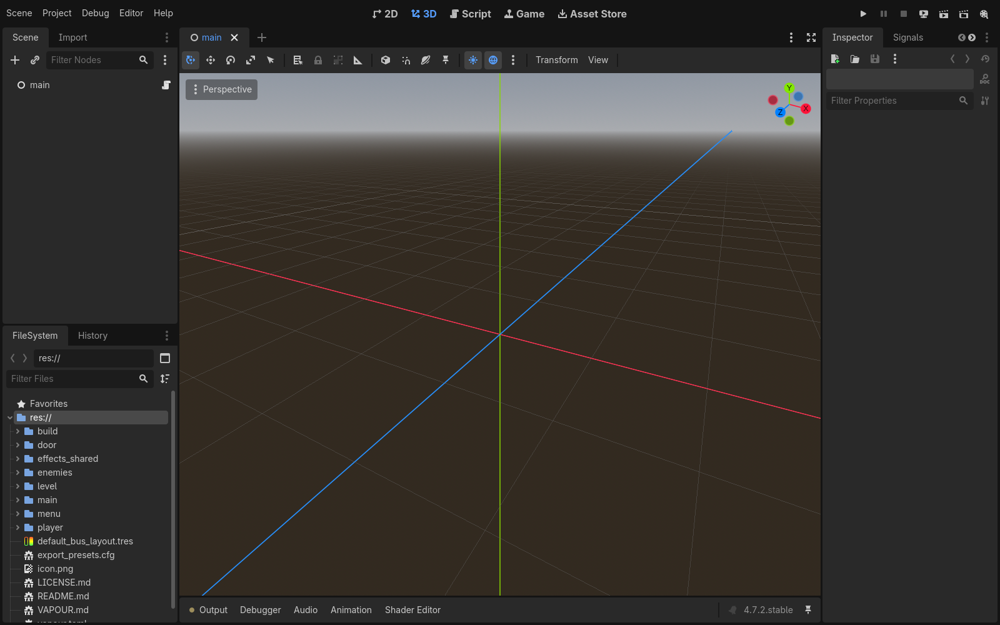
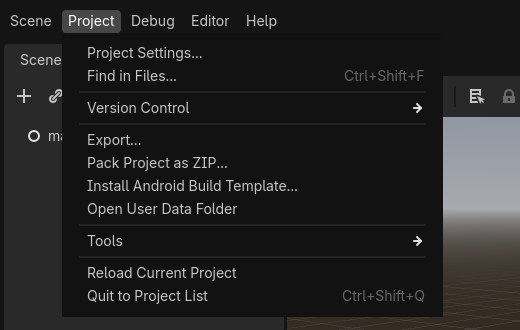
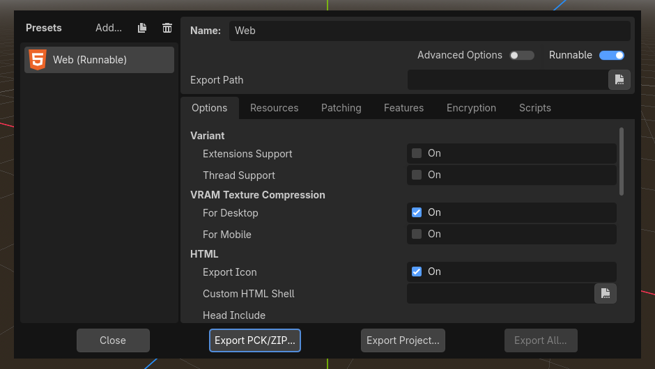
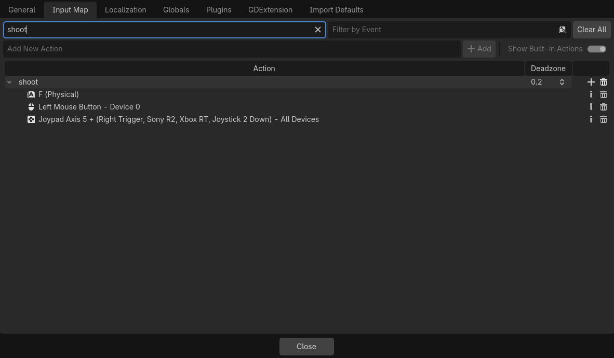
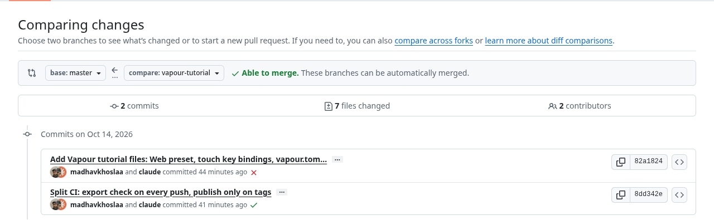
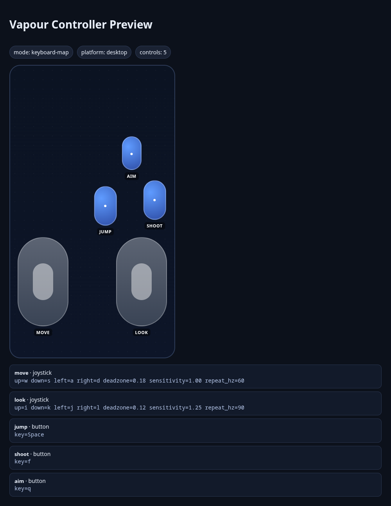
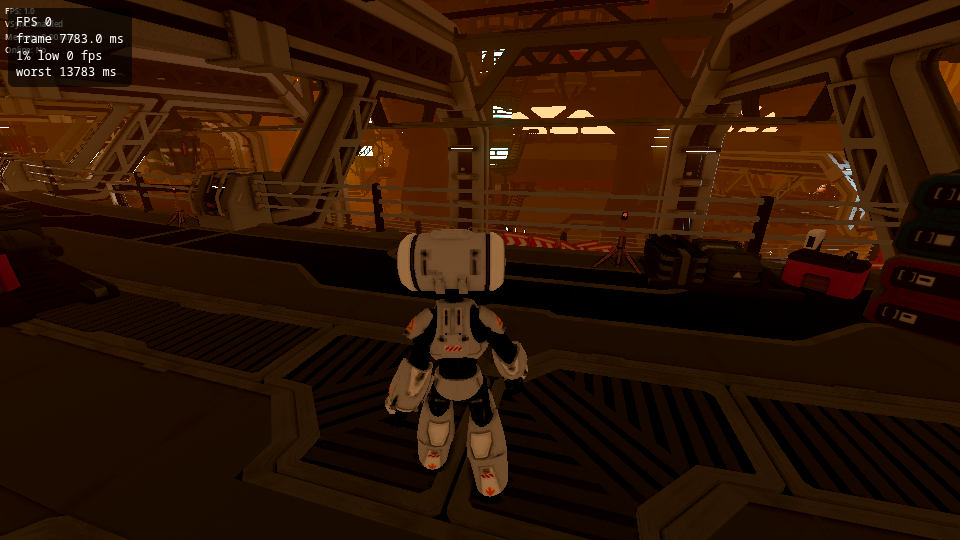
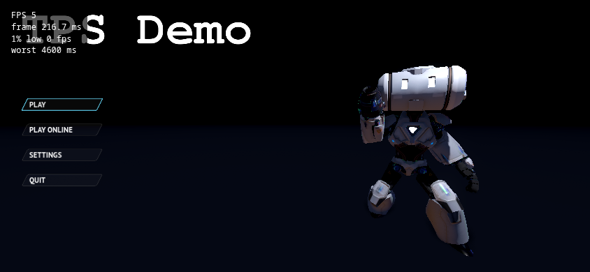

# Tutorial: Godot, from a sample project to a phone-ready web build

<span class="badge badge-preview">Preview tools</span> <span class="badge">Godot 4.7.2</span> <span class="badge">About 30 minutes</span>

You will take the official Godot **third-person shooter demo**, export it for the browser, add on-screen touch
controls for phones, run it locally with an FPS overlay and the profiler, and set up CI. This is exactly what we did
to the sample repository, in the order we did it, including the things that went wrong.

**Sample repository:** [`vapour-computer/tutorial-godot-tps`](https://github.com/vapour-computer/tutorial-godot-tps),
branch `vapour-tutorial`. It is a fork of [`godotengine/tps-demo`](https://github.com/godotengine/tps-demo) (MIT).


*The finished build, served by `vapour test` and captured in headless Chromium. The overlay in the corner is added
only while testing locally. This capture used software rendering with no GPU, so the FPS reads 2; on real hardware
it is far higher. The overlay measures what the browser really does.*

## What is verified, and what is not

| Step | State |
| --- | --- |
| Web export builds with Godot 4.7.2 | **Verified** locally, and on GitHub Actions (the `vapour-check` workflow passes) |
| `vapour test` serves it with the FPS overlay | **Verified** |
| Profiler attaches and records CPU and memory | **Verified** (screenshot below) |
| `vapour publish --dry-run` packs it | **Verified**: 255.1 MiB, under the 512 MiB limit |
| Touch controls validate and preview | **Verified** with `vapour controller check` and `preview` |
| Touch controls working on a real phone | **Not verified.** The player-side overlay is a preview feature we did not test on a device |
| Publishing to Vapour | **Not run.** It needs your token and a released `vapour-ci` (see [status](../status.md)) |

## 1. Get the project

```sh
git clone https://github.com/vapour-computer/tutorial-godot-tps.git
cd tutorial-godot-tps
git checkout vapour-tutorial
```

To follow along from scratch instead, fork `godotengine/tps-demo` and make a `vapour-tutorial` branch. The upstream
project is about 1.3 GB with its history, and the web export is about 600 MB.

Open it in Godot. Our added files, `export_presets.cfg`, `VAPOUR.md` and `vapour.toml`, sit in the file list:



You need **Godot 4.7.2** and its **Web export templates** (Editor → Manage Export Templates). The editor and the
templates must be the same version.

## 2. Add a Web export preset

Godot only exports what a preset describes. Open **Project → Export…**, choose **Add… → Web**, and keep the name
`Web`.

Open **Project → Export…** in the editor:



Then the export window. Here is the finished `Web` preset, with **Thread Support** off:



*The real export window for the sample game.*

We saved the preset as `export_presets.cfg`. These are the entries that matter:

| Setting in the Export dialog | Value |
| --- | --- |
| Preset name | `Web` |
| Platform | `Web` |
| Export filter | All Resources |
| Thread Support | **off** |
| Extensions Support | off |
| VRAM Texture Compression | For Desktop on, For Mobile off |
| Progressive Web App | off |

- **Thread support is off.** Threaded Godot builds need cross-origin isolation headers. `vapour test` sends them, but
  keep the first build simple.
- **The preset must be named `Web` and have platform `Web`.** `vapour build` refuses anything else.

> **A trap we hit:** upstream's `.gitignore` lists `export_presets.cfg`, so the file silently never reached Git. CI
> then failed to find the preset. We removed that line and committed the file.

Export it from the command line. This is also what CI runs:

```sh
mkdir -p build/web
godot --headless --path . --import
godot --headless --path . --export-release "Web" build/web/index.html
```

```text
build/web/
├── index.html
├── index.js            (280 KB)
├── index.wasm          (40 MB)
├── index.pck           (597 MB)   ← the game's data
└── …icons and audio worklets
```

## 3. Give the touch controls something to press

This is the part that needs a little thought. The on-screen controller (see [`[controller]`](../games/manifest.md#controller-preview))
works by **sending keyboard keys**. It can only drive actions that have a key.

We listed the TPS demo's input actions in `project.godot` and checked what each is bound to:

| Action | Keyboard | Mouse | Gamepad |
| --- | --- | --- | --- |
| `move_left` `move_right` `move_forward` `move_back` | **A D W S** and arrows | | left stick |
| `jump` | **Space** | | button 0 |
| `shoot` | none | left button | right trigger |
| `aim` | none | right button | left trigger |
| `view_left` `view_right` `view_up` `view_down` | none | mouse movement | right stick |

Movement and jump are fine. **Shoot, aim and look have no keyboard key**, so a touch screen could not reach them.
We fixed that in the Input Map by giving each a key:

| Action | New key |
| --- | --- |
| `shoot` | **F** |
| `aim` | **Q** |
| `view_left` / `view_right` | **J** / **L** |
| `view_up` / `view_down` | **I** / **K** |



*Project → Project Settings → Input Map, filtered to `shoot`. The **F** key is the one we added. The mouse and gamepad inputs were already there.*

In the Input Map editor, click **+** next to each action, choose **Key**, and press the key. The mouse and gamepad bindings stay, so
desktop play is unchanged. Godot writes the result into `project.godot`. GitHub's comparison of our branch with upstream shows the whole
change at a glance: two commits, seven files.



*GitHub's comparison of `vapour-tutorial` with upstream `master`. The red cross on the first commit is the run that failed
because `vapour-ci@v1` does not exist yet, described in [CI](#6-ci). The second commit's green tick is the fix.*

## 4. Describe the controls in `vapour.toml`

Now map the on-screen controls onto those keys. We used two sticks and three buttons:

| Control | Type | Sends |
| --- | --- | --- |
| `move` (left stick) | joystick | `w` `a` `s` `d` |
| `look` (right stick) | joystick | `i` `j` `k` `l` |
| `jump` | button | `Space` |
| `shoot` | button | `f` |
| `aim` | button | `q` |

```toml
[project]
title = "TPS Demo"
slug = "tutorial-godot-tps"
engine = "godot"
platform = "desktop"
version = "0.1.0"

[build]
dir = "build/web"

[controller]
mode = "keyboard-map"

[[controller.controls]]
id = "move"
type = "joystick"
x = 0.20          # centre, as a fraction of the screen; y grows downward
y = 0.74
w = 0.30
h = 0.30
up = "w"
down = "s"
left = "a"
right = "d"
deadzone = 0.18
sensitivity = 1.0
repeat_hz = 60

[[controller.controls]]
id = "look"
type = "joystick"
x = 0.80
y = 0.74
w = 0.30
h = 0.30
up = "i"
down = "k"
left = "j"
right = "l"
deadzone = 0.12
sensitivity = 1.25   # look needs to be a bit more sensitive than move
repeat_hz = 90

[[controller.controls]]
id = "jump"
type = "button"
x = 0.58
y = 0.48
w = 0.13
h = 0.13
key = "Space"

[[controller.controls]]
id = "shoot"
type = "button"
x = 0.88
y = 0.46
w = 0.13
h = 0.13
key = "f"

[[controller.controls]]
id = "aim"
type = "button"
x = 0.74
y = 0.30
w = 0.11
h = 0.11
key = "q"
```

Every entry is explained in the [`vapour.toml` reference](../games/manifest.md).

Check it, then look at it:

```text
$ vapour controller check
Controller mode: keyboard-map
  move         joystick at (0.20, 0.74) size (0.30, 0.30)
    joystick tuning: deadzone=0.18 sensitivity=1.00 repeat_hz=60
  look         joystick at (0.80, 0.74) size (0.30, 0.30)
    joystick tuning: deadzone=0.12 sensitivity=1.25 repeat_hz=90
  jump         button   at (0.58, 0.48) size (0.13, 0.13)
  shoot        button   at (0.88, 0.46) size (0.13, 0.13)
  aim          button   at (0.74, 0.30) size (0.11, 0.11)
Controller config looks good.
Tip: run `vapour controller preview` to see the layout.
```

```text
$ vapour controller preview
Preview (D=dpad, J=joystick, B=button)
············································
············································
············································
············································
············································
·····························BBBBBB·········
·····························B····B·········
·····························BBBBBB·········
······················BBBBBBB······BBBBBBB··
······················B·····B······B·····B··
······················BBBBBBB······BBBBBBB··
··JJJJJJJJJJJJJJ············JJJJJJJJJJJJJJ··
··J············J············J············J··
··J············J············J············J··
··J············J············J············J··
··J············J············J············J··
··J············J············J············J··
··JJJJJJJJJJJJJJ············JJJJJJJJJJJJJJ··
············································
············································
```

`vapour controller preview --html` writes a page you can open in a browser:



> **A mistake the preview caught.** Our first layout put `jump` at `y = 0.58`, and the ASCII preview showed it
> overlapping the look stick (`JBJJ`). On a phone a thumb could not tell them apart. We moved the buttons up until no
> two controls touched.

## 5. Run it locally

```sh
vapour test
```

```text
Testing TPS Demo v0.1.0 at http://127.0.0.1:41873/
FPS overlay on (local test only). Close the game tab for a summary; Ctrl+C to stop.
eBPF profiler attached to the game browser (CPU and memory, browser plus its processes).
Capture started automatically; open the profiler tab to watch it. The profiler session lasts 5 minutes. Close the browser to stop.
```

The port is chosen for you and differs each run. When you close the game tab, one more line is printed with the
frame count, the average FPS, the 1% low and the worst frame time.

You get a Chromium window with the game and, in a second tab, the profiler. Details of what each shows are in
[Profile your game locally](profile-locally.md). Press **Play** and the real level loads. This is the same build, captured in headless Chromium (software rendering, so it crawls):



*The overlay reports the truth: on software rendering the frame time is 7.8 seconds. On a real GPU it is a different game. The text
under the overlay is the game's own debug readout.*

In a phone-sized window the menu looks like this (an emulated 844 × 390 phone viewport):



Here is the profiler attached to this exact build while it ran
(captured headless, so CPU is high and there is no GPU):


The frame-rate tile reads "No FPS data recorded". That is accurate: the native profiler measures CPU and memory
today, and frame data comes from the overlay.

## 6. CI

Two workflows live in `.github/workflows/`:

- **`vapour-check.yml`** runs on every push and pull request. It exports the Web build in the `barichello/godot-ci`
  container and checks that `index.html` and `index.wasm` exist. It needs no secrets. It passes on the sample repo.
- **`vapour-publish.yml`** runs when you push a tag such as `v0.1.0`. It exports the build and publishes with
  `vapour-computer/vapour-ci@v1`.

> **A trap we hit:** our first version put the publish step inside the push workflow behind an `if`. GitHub resolves an
> action *before* it evaluates any step, and `vapour-ci@v1` is not released yet, so **every** push failed with
> "Unable to resolve action". Splitting publish into its own tag-only workflow fixed it.

To publish, add a `VAPOUR_TOKEN` secret to the repository ([create a token](../auth/tokens.md)) and push a tag.

## 7. Check the size, then publish

```text
$ vapour publish --dry-run --skip-store
Packed build/web (255.1 MiB) as version 0.1.0
Dry run: nothing uploaded.
```

The folder is about 600 MB, but it compresses to **255.1 MiB**, inside the current **512 MiB** upload limit. A game
that does not fit would need the planned [large-game delivery](../games/large-games.md).

When you are ready:

```sh
vapour login --token vpr_...
vapour publish --notes "First tutorial build"
```

## What you learned

- A Web export preset must be named `Web`, and must be committed.
- On-screen controls can only press keys, so give every action you need a key in the Input Map.
- `vapour controller preview` catches overlapping controls before a player does.
- `vapour test` gives you an FPS overlay and a profiler without changing your build.
- Keep the publish step out of workflows that run on every push until `vapour-ci` is released.

Next: the same flow for [Bevy](bevy.md) and [Unity](unity.md).
