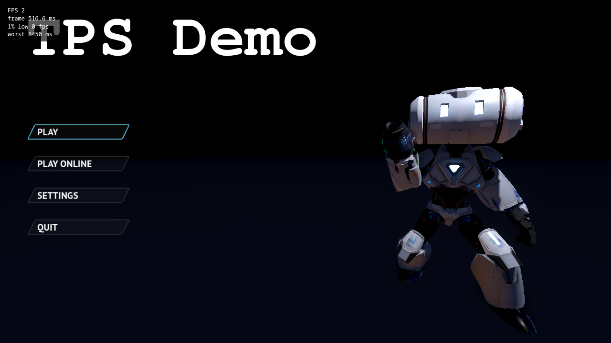
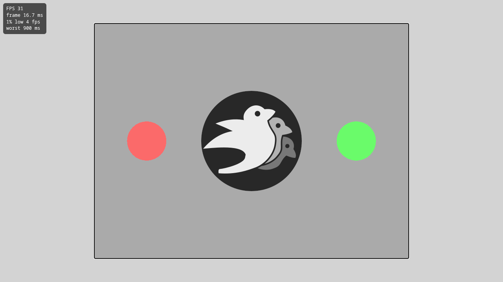
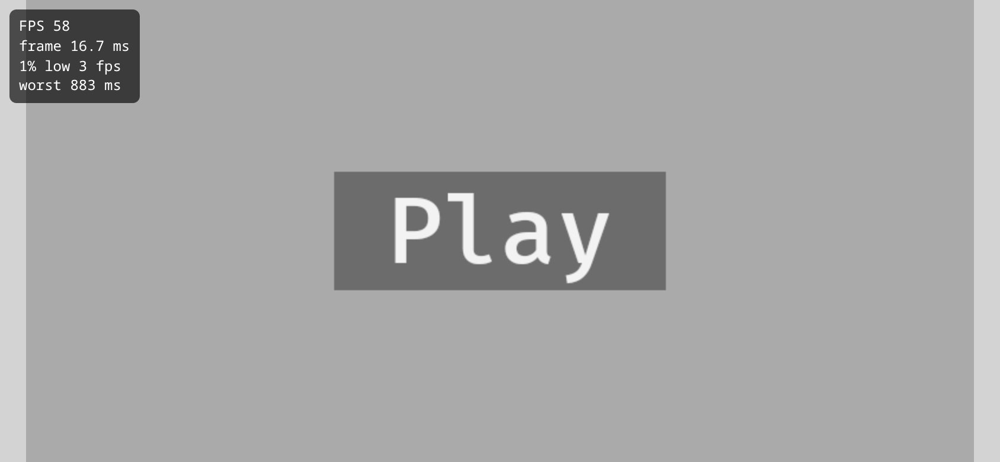
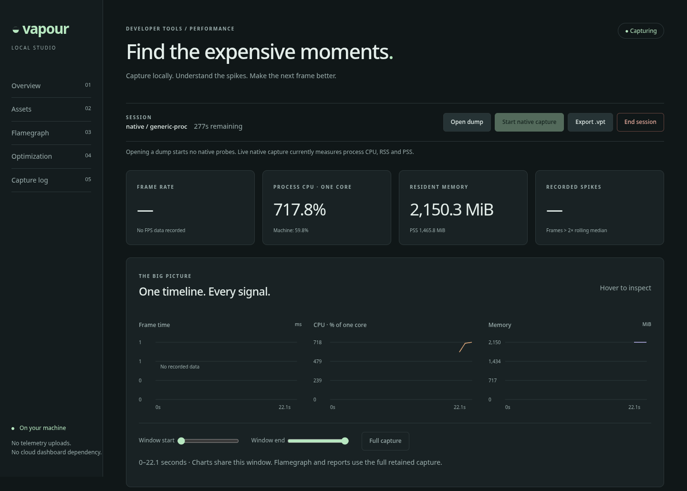
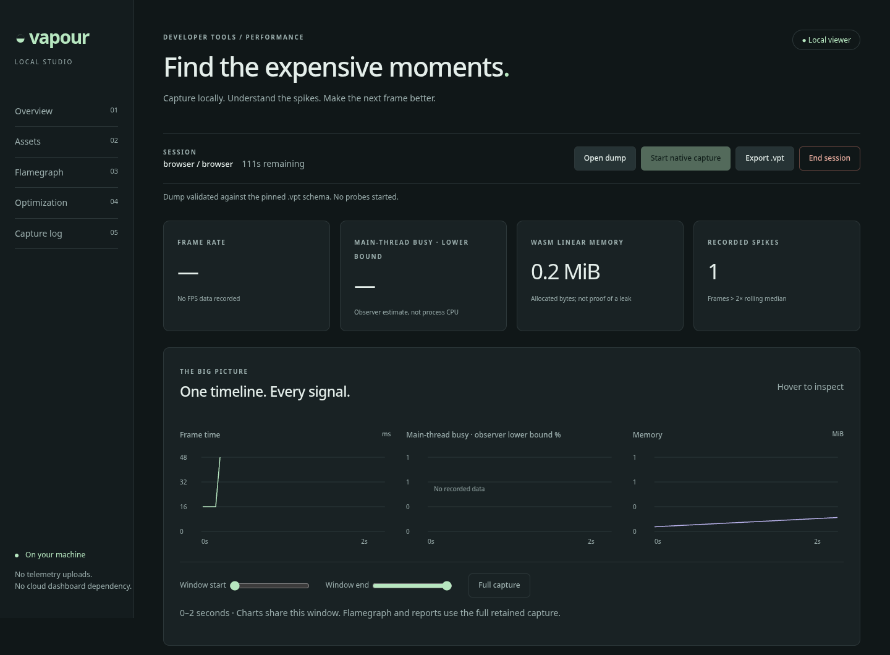
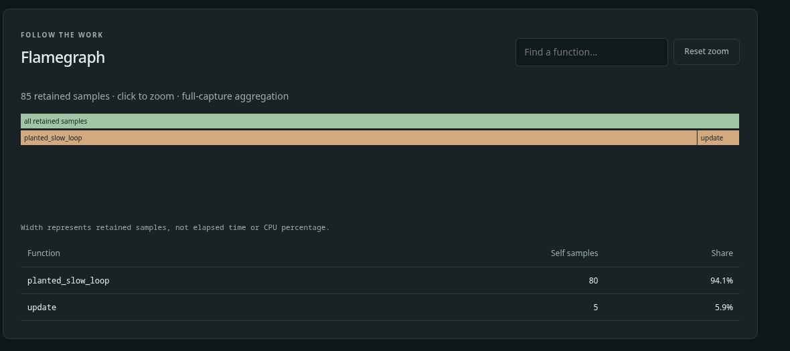
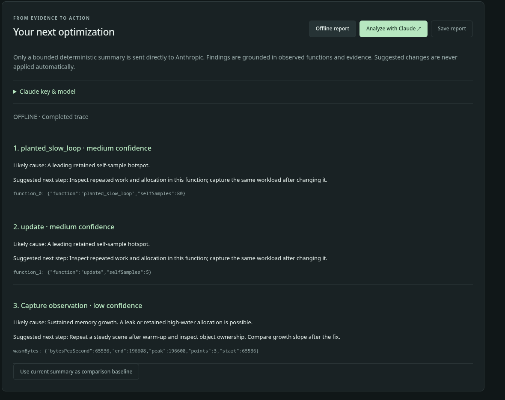

# Tutorial: profile your game locally with `vapour test`

<span class="badge badge-preview">Preview tools</span> <span class="badge">Works for Godot, Unity and Bevy</span> <span class="badge">About 10 minutes</span>

`vapour test` runs your web build on your own machine, shows a live **FPS overlay**, and opens the **profiler** next to
it. Everything stays local: nothing is uploaded, and none of it can end up in a published game.

> **Local only, by design.** The overlay is added to the page while it is being served, and the build folder is never
> modified, so `vapour publish` cannot include it. The Vapour website has no live profiling. See
> [the lifecycle rules](../telemetry/lifecycle.md) for what the tools may and may not do.

## What you need

| You need | Why |
| --- | --- |
| A web build with `build.dir` in `vapour.toml` | `vapour test` serves that folder (or `.zip`) |
| The `vapour` CLI with the `test` command | [Preview](../status.md): it is in an open pull request, not yet a release |
| A Chromium-family browser (Chromium, Chrome, Brave, Edge) | The profiler needs to launch it on its own profile so it can find the browser's process. Firefox-based browsers are not used |
| **Linux** and the `vapour-profiler` binary | For the profiler. On other systems you still get the overlay |

Tell the CLI where the profiler is. It looks, in order, at `--profiler PATH`, the `VAPOUR_PROFILER` environment variable,
a `vapour-profiler` file **next to the `vapour` binary**, and your `PATH`.

## Run it

```sh
cd my-game          # the folder with vapour.toml
vapour test
```

```text
Testing TPS Demo v0.1.0 at http://127.0.0.1:41873/
FPS overlay on (local test only). Close the game tab for a summary; Ctrl+C to stop.
eBPF profiler attached to the game browser (CPU and memory, browser plus its processes).
Capture started automatically; open the profiler tab to watch it. The profiler session lasts 5 minutes. Close the browser to stop.
```

A Chromium window opens with two tabs: **your game**, and **the profiler dashboard**. Capture has already started. To
stop, close the browser or press Ctrl+C: the profiler, the browser and the temporary browser profile are all removed.

If the profiler or a suitable browser is missing, `vapour test` says why and carries on with just the overlay:

```text
Profiler not started: vapour-profiler not found: pass --profiler /path/to/vapour-profiler, set VAPOUR_PROFILER, put it next to the vapour binary, or put it on PATH
Continuing with the FPS overlay only.
```

### Flags

| Flag | What it does |
| --- | --- |
| `--dir DIR` | The game folder holding `vapour.toml`. Default `.` |
| `--port N` | Port on `127.0.0.1` for your game. Default: a free port |
| `--no-telemetry` | Do not add the FPS overlay |
| `--no-profile` | Do not start the profiler |
| `--no-open` | Do not open a browser (this also skips the profiler, which needs to launch the browser itself) |
| `--profiler PATH` | The `vapour-profiler` binary |

## The FPS overlay



*Captured in headless Chromium with software rendering, so the FPS is low. On a real GPU it will be far higher.*

The four lines mean:

| Line | Meaning |
| --- | --- |
| `FPS` | Frames drawn, averaged over the last half second |
| `frame` | How long the most recent frame took, in milliseconds |
| `1% low` | The speed of your worst frames: the slowest 1% of the last 1,200 frames (about 20 seconds at 60 FPS), shown as FPS. Shows `0` until 20 frames have been drawn |
| `worst` | The longest single frame since the page loaded |

Here is a real example. This is the Bevy sample game right after pressing **Play**:



*The average looks fine at 31 FPS, but the 1% low of 4 FPS and the 900 ms worst frame reveal the start-up hitch. The average hid it.*

The **1% low** is the number players feel. A game can average 60 FPS and still stutter; a low 1% low is how you spot it.
Toggle the overlay with **Ctrl+Shift+F**.

The overlay measures `requestAnimationFrame` timing, which is what the browser actually presents. It does **not** measure
GPU time.

When the page is closed or the tab is hidden, the overlay sends a summary to the local `vapour test` process, which
prints it:

```text
Session: <frames> frames, avg <n> fps, 1% low <n> fps, worst frame <n> ms
```

(Switching to the profiler tab hides the game tab, so you will see this line then too.)

You can also test in a phone-sized window with your browser's device emulation. Here is the same game at 844 × 390 with touch enabled:



## The profiler



*The profiler attached to the Godot TPS build while it ran in headless Chromium.*

What it measures **today**, once a second:

| Tile | Meaning |
| --- | --- |
| **Process CPU · one core** | CPU time used by the browser *and all its child processes* (renderer, GPU, workers), as a percentage of one core. `717.8%` means about seven cores' worth. The small line underneath gives the share of the whole machine |
| **Resident memory** | RAM the browser and its children are using. `PSS` is a fairer figure that counts shared memory once, where the system allows reading it |
| **Frame rate** | Empty here: *No FPS data recorded*. The native profiler does not measure frames. Use the overlay, or import a trace that has them |
| **Recorded spikes** | Frames more than twice the rolling median. Needs frame data |

The dashboard also has an **Asset load cost** panel that ranks textures and other files by how hard they were to load. A live native
capture leaves it empty, because nothing records `asset` events from a running game yet: see
[Find expensive assets](../analysis/assets.md).

What it does **not** do yet: it records no function-level stacks (so the flamegraph is empty for a live native capture),
no GPU data and no FPS. Those are planned. The page says so itself, rather than inventing numbers.

A session lasts at most **five minutes**. When it ends, run `vapour test` again.

### Look at a trace

You can open a saved trace (`.vpt`) or a folded-stacks file (`.folded`) with **Open dump**. Nothing is started when you do:
a dump is only read. Using the book's small [sample trace](../.gitbook/assets/browser-sample.vpt) (illustrative data, not a
real game), the dashboard shows the timeline:



the flamegraph, where the width of a bar is the number of samples, not time:



and an **offline report**, which ranks suspects from the evidence and never edits your code:



See [Read a performance report](../analysis/worked-example.md) for how to read each part, and
[Export and validate dumps](../analysis/dumps.md) for the file format.

## How it works

You do not need this to use it, but it explains the guarantees:

1. `vapour test` reads `vapour.toml`, validates it, and starts a small web server on `127.0.0.1` (loopback only).
2. It sends the cross-origin isolation headers (COOP and COEP) that threaded WebAssembly needs, and the right type for `.wasm`.
3. When it serves `index.html` it adds one script tag, pointing at `/__vapour/fps.js`, **in memory**. Your files are untouched.
4. It launches Chromium on a **private, temporary profile**. That makes it a separate process whose ID the CLI knows. (Reusing
   your everyday browser would hand the page to an existing process and leave nothing to attach to.)
5. It starts `vapour-profiler dashboard --pid <browser> --tree --autostart`. `--tree` adds up the browser's child processes;
   `--autostart` starts capture straight away. Both exist only because you ran this command: the profiler never starts
   anything on its own.
6. It opens the dashboard as a second tab and waits. When you quit, it stops the profiler and the browser and deletes the
   temporary profile.

The overlay's summary goes to a local endpoint that only accepts posts from the same origin. The dashboard needs a random
token that is printed only to the launching process. Nothing is sent to Vapour.

## If it does not work

| You see | Do this |
| --- | --- |
| `Profiler not started: vapour-profiler not found …` | Pass `--profiler`, set `VAPOUR_PROFILER`, or put the binary next to `vapour` |
| `no Chromium-family browser found` | Install Chromium or Chrome |
| `profiler did not print a dashboard URL (is port 6767 already in use?)` | Another profiler session is running. Close it; the profiler never kills the process that holds the port |
| `browser exited immediately` | The browser could not start on a fresh profile. Try launching it by hand to see its error |
| FPS is 2 or 3 in a screenshot or CI | You are on software rendering with no GPU. The overlay is reporting the truth |
| Nothing at all happens with `--no-open` | Expected: it only serves. Open the printed address yourself |

## What you learned

- `vapour test` is local only and never touches your build.
- The overlay answers "is my game smooth for players?"; the profiler answers "where is the machine's time going?".
- Use the **1% low**, not the average, to find stutter.
- The profiler records CPU and memory today. Stacks and FPS in the profiler are future work.
