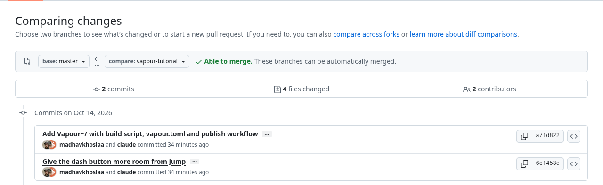
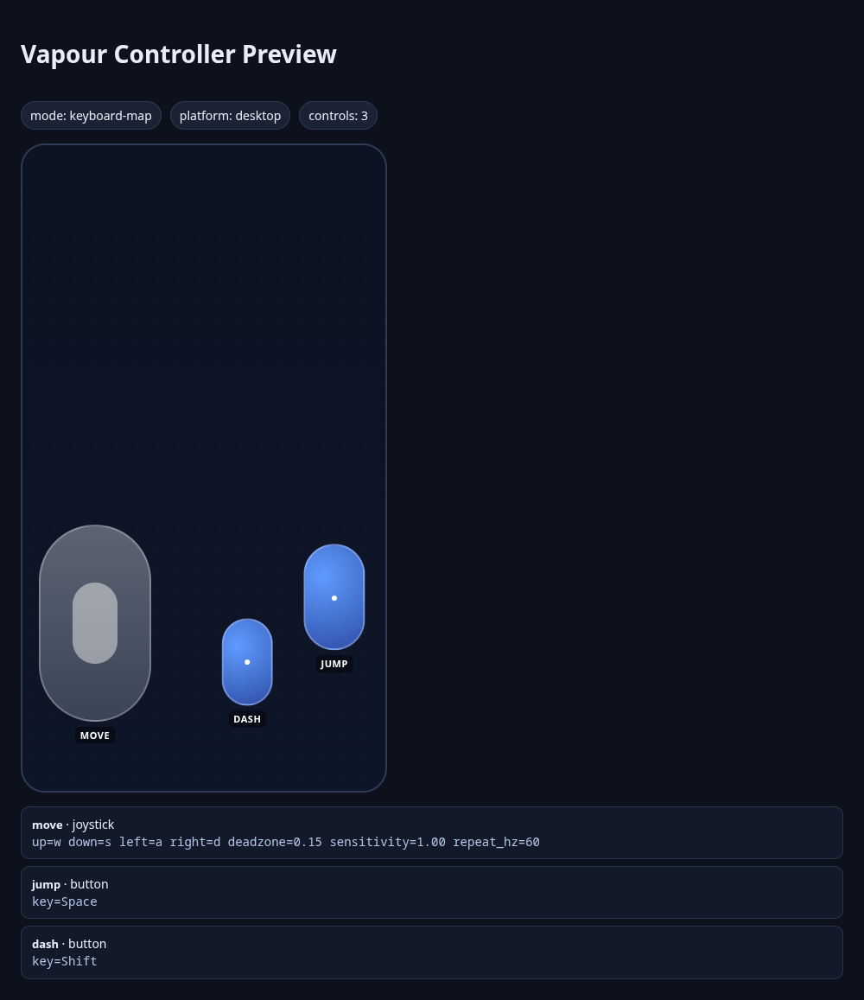

# Tutorial: Unity, from a package sample to a WebGL build

<span class="badge badge-preview">Preview tools</span> <span class="badge badge-warn">Not built by us</span> <span class="badge">Unity 2022 LTS or Unity 6</span>

You will create a Unity project around a small 2D platformer sample, wire it to Vapour, add on-screen touch controls
for phones, and build a WebGL export from the command line and from CI.

> **Read this first: we did not build this one.** The machine we wrote the tutorials on has no Unity editor and no
> Unity license, so we could not produce a WebGL build. The **Vapour side** (the manifest, the touch layout, the
> build script and the CI file) was written from the CLI source and **validated with real commands**. The **Unity
> side** (menus, settings, the build itself) follows Unity's documentation and the sample's code, and is untested.
> If a step breaks, it is a bug in this page: please [tell us](https://github.com/vapour-computer/vapour-dev-docs/issues).

**Sample repository:** [`vapour-computer/tutorial-unity-platformer`](https://github.com/vapour-computer/tutorial-unity-platformer),
branch `vapour-tutorial`. It is a fork of [`ta-david-yu/2D-Platformer-Hunter`](https://github.com/ta-david-yu/2D-Platformer-Hunter)
(MIT), a raycast-based 2D platformer controller.

## What is verified, and what is not

| Step | State |
| --- | --- |
| `vapour.toml` and the touch layout validate | **Verified** with `vapour controller check` and `preview` |
| The layout has no overlapping controls | **Verified** (screenshot below) |
| `VapourBuild.cs` matches what `vapour build` expects | **Verified against the CLI source**; it is the file `vapour create --engine unity` writes |
| The sample really reads the keys we map | **Verified from its code** (`PlayerBasicMovementInput.cs`) |
| Importing the package and its sample | Not run |
| The WebGL build, `vapour build`, `vapour test` | Not run |
| The CI workflow | Not run: it needs Unity license secrets |

GitHub's comparison of the fork's branch with upstream shows exactly what we added: a single hidden folder.



## 1. Understand the sample

The repository is a Unity **package**, not a complete project. That is why this tutorial starts by creating a project.
It contains two playable scenes, `00-BasicController` and `01-AdvancedLevel`, in a sample called **Playground Samples**.

Its player script (`PlayerBasicMovementInput.cs`) reads Unity's **legacy Input Manager**: two axes, `Horizontal` and `Vertical`, and
two buttons, `Jump` and `Fire3`.

In a default Unity input setup those names mean:

| Name | Default keys |
| --- | --- |
| `Horizontal` | **A** and **D**, left and right arrows |
| `Vertical` | **W** and **S**, up and down arrows |
| `Jump` | **Space** |
| `Fire3` | **Left Shift** |

That list is what the touch controls must press.

## 2. Create the project

In Unity Hub, create a new **2D** project with a Unity 2022 LTS or Unity 6 editor.

## 3. Add the package and import the sample

In the editor: **Window → Package Manager → + → Add package from git URL…** and paste:

```text
https://github.com/vapour-computer/tutorial-unity-platformer.git#vapour-tutorial
```

Then select the package in the list, open its **Samples** tab and click **Import** next to **Playground Samples**.

<figure class="shot-slot">
  <div class="shot-slot__box">
    <strong>Screenshot slot</strong>
    <span>Unity: Package Manager showing “DY.2D Platformer Hunter”, with the Samples tab and the Import button for “Playground Samples”.</span>
  </div>
  <figcaption>Save as <code>book/assets/img/unity-package-manager.png</code>.</figcaption>
</figure>

## 4. Make the legacy input work

> **Check this one.** New Unity 6 projects usually default to the **new Input System** package. The sample uses the
> **old** `Input` class, which throws an error in that mode.

Open **Edit → Project Settings → Player → Other Settings** and set **Active Input Handling** to
**Input Manager (Old)** or **Both**. Unity restarts the editor.

## 5. Put a scene in the build

`vapour build` runs Unity without a window, and the build script needs at least one enabled scene. Open
**File → Build Profiles** (older editors: **Build Settings**), then:

1. Choose the **Web** platform and click **Switch Platform**.
2. Click **Add Open Scenes** after opening `00-BasicController`. The path will look like:

```text
Assets/Samples/DY.2D Platformer Hunter/0.2.2-preview.1/Playground Samples/Scenes/00-BasicController.unity
```

<figure class="shot-slot">
  <div class="shot-slot__box">
    <strong>Screenshot slot</strong>
    <span>Unity: Build Profiles with the Web platform selected and 00-BasicController ticked under Scenes In Build.</span>
  </div>
  <figcaption>Save as <code>book/assets/img/unity-build-profiles.png</code>.</figcaption>
</figure>

Under **Player Settings → Publishing Settings** set **Compression Format** to **Disabled**, or turn on **Decompression
Fallback**. An uncompressed export is the simplest first build. Compressed files need the right `Content-Encoding`
headers from the server.

For WebGPU and **Code Optimization**, see [Make your web build fast](fast-web-builds.md#7-unity-webgpu).

## 6. Add the Vapour build script

Copy `Vapour~/Assets/Editor/VapourBuild.cs` from the sample repository into your project at
`Assets/Editor/VapourBuild.cs`. It is the same script `vapour create --engine unity` writes, and you do not need to edit it.

What it does:

- It reads the output folder from the `-vapourOutput` argument that `vapour build` passes, and falls back to `build/web`.
- It builds every scene you ticked in Build Settings, for the WebGL target.
- It throws if nothing is ticked or the build fails. In batch mode a thrown exception makes Unity exit with an error,
  so `vapour build` and CI stop instead of publishing nothing.
- The `[MenuItem]` line adds **Vapour → Build** to the editor, so you can run the same code by hand.

## 7. Describe the game and the touch controls

Copy `Vapour~/vapour.toml` to the root of the project, next to `Assets/` and `ProjectSettings/`:

```toml
[project]
title = "Platformer Playground"
slug = "tutorial-unity-platformer"
engine = "unity"
platform = "desktop"
version = "0.1.0"

[build]
dir = "build/web"

[runtime]
on_quit = "store"

[controller]
mode = "keyboard-map"

[[controller.controls]]
id = "move"
type = "joystick"
x = 0.20
y = 0.74
w = 0.30
h = 0.30
up = "w"
down = "s"
left = "a"
right = "d"
deadzone = 0.15
sensitivity = 1.0
repeat_hz = 60

[[controller.controls]]
id = "jump"
type = "button"
x = 0.86
y = 0.70
w = 0.16
h = 0.16
key = "Space"

[[controller.controls]]
id = "dash"
type = "button"
x = 0.62
y = 0.80
w = 0.13
h = 0.13
key = "Shift"
```

The stick presses the keys behind `Horizontal` and `Vertical`; the buttons press `Jump` and `Fire3`. Every entry is explained
in the [`vapour.toml` reference](../games/manifest.md).

```text
$ vapour controller check
Controller mode: keyboard-map
  move         joystick at (0.20, 0.74) size (0.30, 0.30)
    joystick tuning: deadzone=0.15 sensitivity=1.00 repeat_hz=60
  jump         button   at (0.86, 0.70) size (0.16, 0.16)
  dash         button   at (0.62, 0.80) size (0.13, 0.13)
Controller config looks good.
Tip: run `vapour controller preview` to see the layout.
```



> **Check the key name.** `Shift` is our best guess for how the player names Left Shift. If dash does not respond on
> a phone, this is the first thing to try changing. We could not test it against the player.

### Quitting and the mouse

On WebGL, do not call `Application.Quit()` directly from gameplay code. Use the Vapour bridge method from the package
(`VapourBridge.Quit()`), which signals the player runtime and lets `runtime.on_quit` choose what happens next
(`store`, `home`, `reload`, `stay`).

For mouse capture, request pointer lock from a real click in gameplay. If the browser drops lock (Esc/tab switch), the
player shows a click-to-resume prompt; on touch-only devices this prompt is skipped.

## 8. Build from the command line

`vapour build` needs three things: `Assets/Editor/VapourBuild.cs`, `ProjectSettings/ProjectVersion.txt` and
`Packages/manifest.json`. Tell it where your editor is:

```sh
export UNITY_EDITOR=/path/to/Unity/Editor/Unity     # or have `Unity` on your PATH
vapour build
```

Under the hood this runs Unity in batch mode:

```sh
Unity -batchmode -quit -nographics \
      -projectPath . \
      -buildTarget WebGL \
      -executeMethod Vapour.Build.Perform \
      -vapourOutput build/web \
      -logFile -
```

It then checks that `build/web/index.html` exists and writes `.vapour/build.json`, a list of every file with its size and
whether it is needed at boot. If your project has large content and the `com.unity.addressables` package is missing,
`vapour build` warns you to split it into remote Addressables bundles.

## 9. Run it locally

```sh
vapour test
```

You get your build in a Chromium window with an FPS overlay, and the profiler in a second tab. See
[Profile your game locally](profile-locally.md).

## 10. CI with GameCI

Copy `Vapour~/vapour-publish.yml` to `.github/workflows/vapour-publish.yml` in your project. It builds with
[GameCI](https://game.ci) and publishes when you push a tag such as `v0.1.0`:

The workflow, in order:

1. Runs when you push a tag that starts with `v`, such as `v0.1.0`.
2. Checks out your project, including Git LFS files.
3. Builds the `WebGL` target with GameCI's `unity-builder`, using your Unity license secrets.
4. Copies the build from `build/WebGL/WebGL/` to `build/web/`, where `vapour.toml` expects it.
5. Publishes with `vapour-computer/vapour-ci@v1`, using your `VAPOUR_TOKEN` secret and the tag as the version.

You need four repository secrets: `UNITY_LICENSE`, `UNITY_EMAIL`, `UNITY_PASSWORD` (see
[GameCI activation](https://game.ci/docs/github/activation)) and `VAPOUR_TOKEN`
([create a token](../auth/tokens.md)). Keep this in its own tag-only workflow: `vapour-ci@v1` is not released yet, and
GitHub fails any job that references an action it cannot find (the [Godot tutorial](godot.md) explains how we hit this).

GameCI writes the build to `build/WebGL/WebGL/`. That layout can differ between builder versions, so open the build log
and confirm the path before you trust the `cp` step.

## If it does not work

| Symptom | Likely cause |
| --- | --- |
| `InvalidOperationException … You are trying to read Input using the UnityEngine.Input class` | Step 4: Active Input Handling is set to the new Input System only |
| `Enable at least one scene in Build Settings.` | Step 5: no scene is ticked |
| `install the Vapour/Build editor script from vapour create` | Step 6: `Assets/Editor/VapourBuild.cs` is missing |
| `UNITY_EDITOR` or `Unity is required; install it yourself or set UNITY_EDITOR` | Step 8: `vapour build` cannot find the editor |
| The page loads but the game never starts | Compressed build served without the right headers: set Compression Format to Disabled |
| The sample's `Input` calls do nothing on a phone | Check the key names in `vapour.toml` against step 1 |

Next: the same flow for [Godot](godot.md) and [Bevy](bevy.md).
